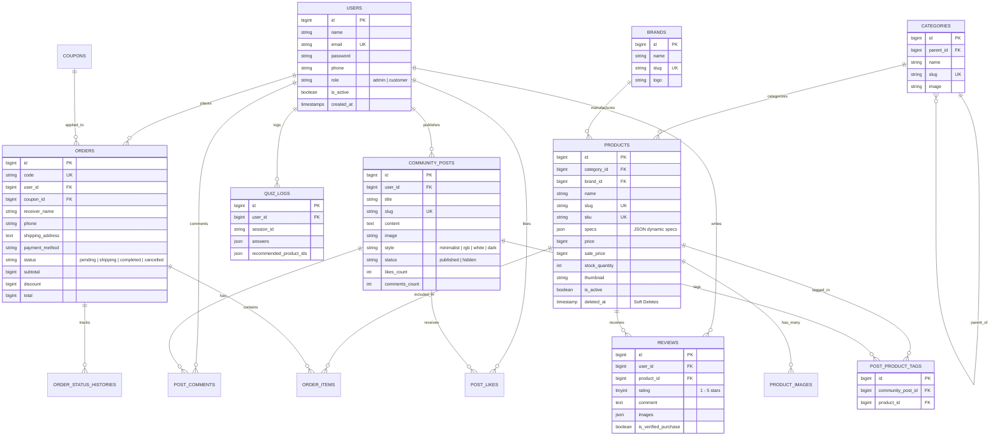
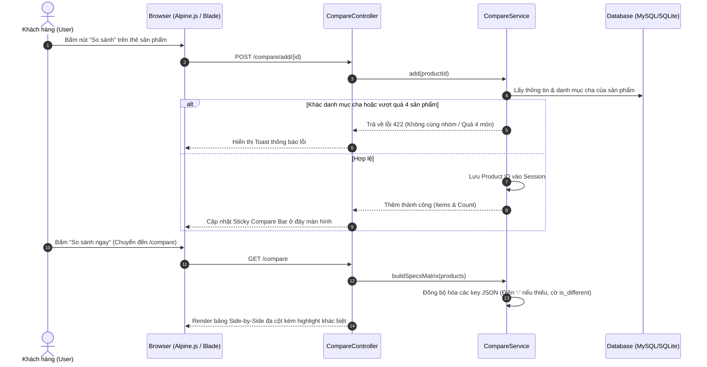
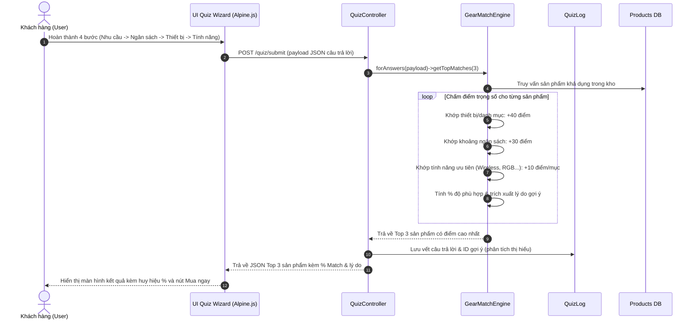
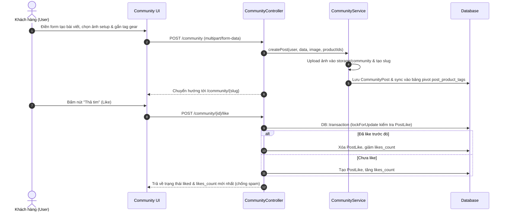

# KIẾN TRÚC HỆ THỐNG VÀ SƠ ĐỒ ĐỒ ÁN GEARHUB

---

## 1. SƠ ĐỒ CƠ SỞ DỮ LIỆU QUAN HỆ CHUẨN 3NF (ERD)

---

## 2. CÁC SƠ ĐỒ TUẦN TỰ (SEQUENCE DIAGRAMS)

### 2.1. Luồng So sánh Sản phẩm & Ma trận Thông số (Compare & Specs Matrix)

---

### 2.2. Luồng Smart Gear Finder Quiz & Match Engine

---

### 2.3. Luồng Diễn đàn Social Commerce Khoe góc máy (Community & Tagging)

