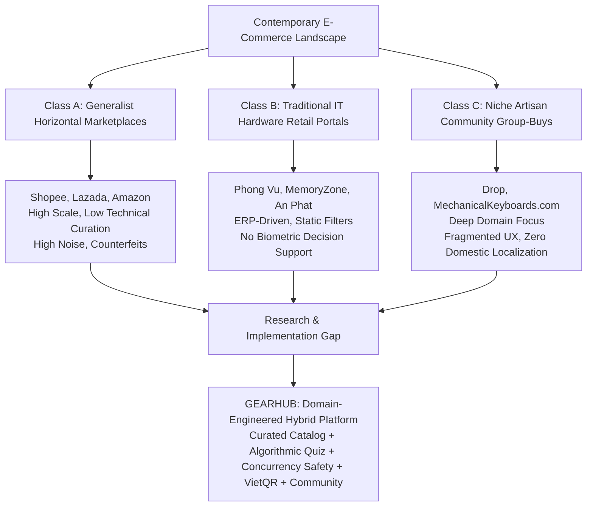
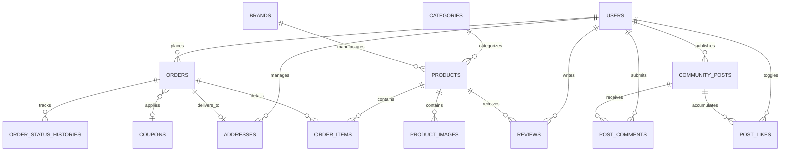
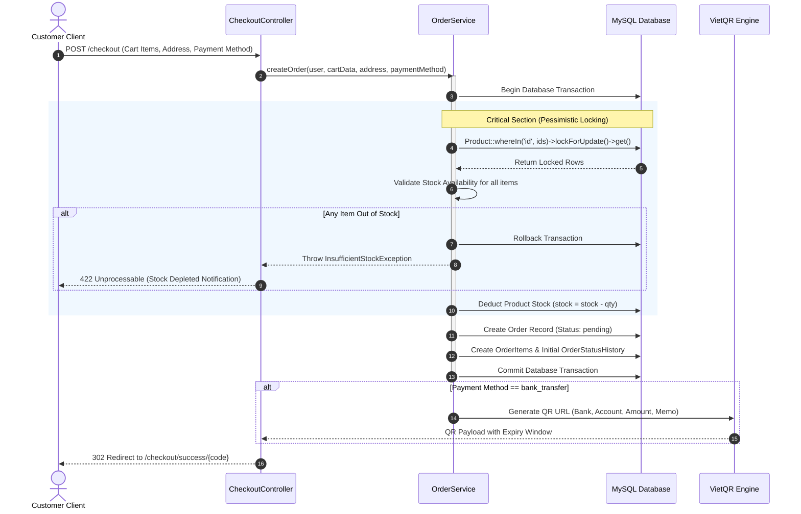
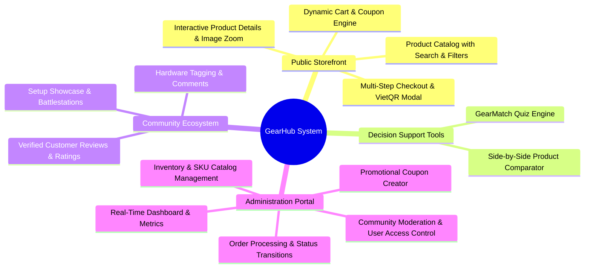
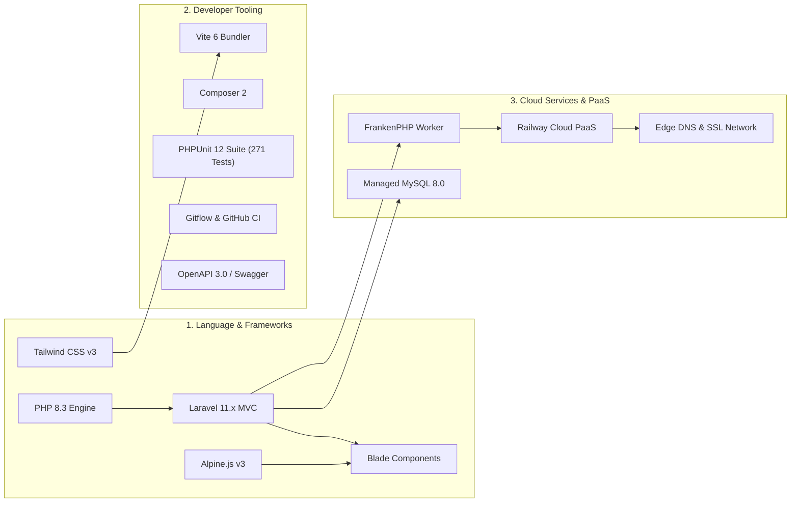

# GEARHUB
## Next-Gen Gaming Gear & Tech Ecosystem E-Commerce Platform
### A High-Performance Web Application with Algorithmic Recommendation & Concurrency-Safe Transaction Engine

---

**Course**: Web Application Development  
**Institution**: University of Information Technology – Vietnam National University, Ho Chi Minh City (UIT – VNU-HCM)  
**Author / Team**: GearHub Development Team  
**Supervising Lecturer**: Academic Project Evaluation Board  
**Academic Year**: 2026 – 2027  
**Submission Date**: November 2026  
**Live Production URL**: [https://www.gearhub.io.vn](https://www.gearhub.io.vn)  
**Interactive API Documentation**: [https://www.gearhub.io.vn/docs/api](https://www.gearhub.io.vn/docs/api)  
**Repository**: [https://github.com/tranhuuthang224/GearHub](https://github.com/tranhuuthang224/GearHub)  

---

## Executive Summary (Project Trailer)

> **In a multi-billion dollar gaming peripheral industry plagued by choice paralysis, counterfeit equipment, and fragmented enthusiast communities, how does an e-commerce platform transition from a static digital warehouse into an intelligent, community-driven decision engine?**

**GearHub** is a production-grade, domain-specialized e-commerce and community web application engineered specifically for gaming peripherals, mechanical keyboards, esports mice, audio systems, and workstation setups. Moving beyond conventional CRUD web applications, GearHub solves three fundamental bottlenecks in consumer tech commerce:
1. **Decision Fatigue**: An algorithmic rule-based recommendation engine (**GearMatch Engine**) that translates biometric parameters (hand measurements, grip style, wrist fatigue, audio preferences) into customized hardware pairings.
2. **Transaction Integrity Under Concurrency**: A concurrency-safe ordering pipeline utilizing pessimistic row-level locking (`SELECT ... FOR UPDATE`), transaction rollback boundaries, and an automated background expiry daemon to eliminate overselling (race conditions) during high-demand product drops.
3. **Frictionless Domestic Commerce**: Native **VietQR** payment integration with automated dynamic transfer code matching, side-by-side technical specification comparators, and a community setup showcase that merges social validation directly with point-of-sale conversion.

Built on PHP 8.3, Laravel 11.x, Alpine.js, Tailwind CSS, and deployed via containerized cloud infrastructure on Railway with managed MySQL and SSL edge routing, GearHub represents a robust blend of modern software architecture, rigorous defensive engineering, and verified test-driven reliability.

---

## Table of Contents

- [1. Introduction, Literature Review & Problem Formulation](#1-introduction-literature-review--problem-formulation)
  - [1.1 Domain Context & Market Landscape](#11-domain-context--market-landscape)
  - [1.2 Categorical Taxonomy of Modern E-Commerce Platforms](#12-categorical-taxonomy-of-modern-e-commerce-platforms)
  - [1.3 Synthesis & Comparative Matrix](#13-synthesis--comparative-matrix)
  - [1.4 Research & Engineering Gaps](#14-research--engineering-gaps)
  - [1.5 Project Motivation & Core Engineering Objectives](#15-project-motivation--core-engineering-objectives)
- [2. System Analysis & Architectural Design](#2-system-analysis--architectural-design)
  - [2.1 Multi-Tier System Architecture](#21-multi-tier-system-architecture)
  - [2.2 Database Schema & Entity Relationship Architecture (ERD)](#22-database-schema--entity-relationship-architecture-erd)
  - [2.3 Principal Business & Technical Workflows](#23-principal-business--technical-workflows)
  - [2.4 UI/UX Paradigm & Design Identity](#24-uiux-paradigm--design-identity)
  - [2.5 Functional Module Decomposition](#25-functional-module-decomposition)
- [3. Engineering Highlights & Competitive Differentiators](#3-engineering-highlights--competitive-differentiators)
  - [3.1 High-Concurrency Inventory Locking & Race Condition Prevention](#31-high-concurrency-inventory-locking--race-condition-prevention)
  - [3.2 Multi-Vector Algorithmic Recommendation Engine (GearMatch)](#32-multi-vector-algorithmic-recommendation-engine-gearmatch)
  - [3.3 Real-Time Dynamic VietQR Integration & Expiry Daemon](#33-real-time-dynamic-vietqr-integration--expiry-daemon)
  - [3.4 Dual-Mode Heterogeneous Hardware Specification Comparator](#34-dual-mode-heterogeneous-hardware-specification-comparator)
  - [3.5 Community Setup Showcase with Engagement & Moderation Architecture](#35-community-setup-showcase-with-engagement--moderation-architecture)
  - [3.6 Edge Network, Reverse-Proxy Hardening & Mixed-Content Zero-Tolerance](#36-edge-network-reverse-proxy-hardening--mixed-content-zero-tolerance)
- [4. Technology Stack & Production Infrastructure](#4-technology-stack--production-infrastructure)
  - [4.1 Languages, Runtimes & Core Frameworks](#41-languages-runtimes--core-frameworks)
  - [4.2 Engineering Tooling & Quality Assurance Suite](#42-engineering-tooling--quality-assurance-suite)
  - [4.3 Production Deployment & Cloud Infrastructure](#43-production-deployment--cloud-infrastructure)
- [5. Empirical Results, Verification & Conclusion](#5-empirical-results-verification--conclusion)
  - [5.1 Comprehensive Verification & Test Suite Metrics](#51-comprehensive-verification--test-suite-metrics)
  - [5.2 Concurrency & Stress Verification](#52-concurrency--stress-verification)
  - [5.3 Objective Assessment & Critical Evaluation](#53-objective-assessment--critical-evaluation)
  - [5.4 Lessons Learned & Future Roadmap](#54-lessons-learned--future-roadmap)
- [6. Project Artifacts, Live Access & References](#6-project-artifacts-live-access--references)
  - [6.1 Live Production Endpoints & Repository](#61-live-production-endpoints--repository)
  - [6.2 References & Technical Standards](#62-references--technical-standards)

---

## 1. Introduction, Literature Review & Problem Formulation

### 1.1 Domain Context & Market Landscape

The global gaming peripheral and enthusiast computer hardware market has transitioned over the past decade from a niche enthusiast subculture into a multi-billion-dollar mainstream industry. Driven by the proliferation of competitive esports, remote professional knowledge work, and personal ergonomics awareness, consumers no longer purchase computer accessories simply as commodity input/output devices. Mice, mechanical keyboards, studio monitors, headsets, and desk pads are now treated as precision ergonomic instruments where microscopic variances in sensor latency, actuation force, switch acoustics, grip geometry, and weight distribution directly dictate user performance and physical comfort.

However, the rapid influx of specialized hardware manufacturers (e.g., custom mechanical keyboard builders, artisan mouse switch creators, esports-grade optical sensor developers) has created a significant informational asymmetry in digital commerce. Online retail environments have historically developed around generalized product models that fail to capture the nuanced taxonomy and subjective compatibility metrics inherent to gaming hardware.

### 1.2 Categorical Taxonomy of Modern E-Commerce Platforms

To contextualize where GearHub resides within contemporary internet software architecture, existing commercial web systems can be classified into three distinct architectural archetypes:



#### Class A: Generalist Horizontal Marketplaces (e.g., Shopee, Lazada, Amazon)
- **Architectural Philosophy**: Extreme scale, distributed microservices, multi-vendor marketplace architecture.
- **Operational Reality**: These platforms optimize for inventory breadth rather than vertical depth. Products are treated as generic alphanumeric stock-keeping units (SKUs). 
- **User Experience Failure**: Searching for an esports mouse on a horizontal marketplace returns thousands of unstructured listings, counterfeit clones, and unverified seller reviews. Crucial ergonomic attributes (e.g., grip style suitability, hand length ranges, sensor smoothing algorithms) are relegated to arbitrary free-text seller descriptions, resulting in severe choice paralysis and high return rates.

#### Class B: Traditional IT & Electronics Retail Portals (e.g., Phong Vu, MemoryZone, An Phat)
- **Architectural Philosophy**: Monolithic ERP/warehouse-driven storefronts designed around traditional component categories (CPU, RAM, Mainboard).
- **Operational Reality**: While authentic hardware is guaranteed, the filtering mechanics remain rigidly hierarchical and technical (e.g., filtering keyboards solely by brand, connection type, or price).
- **User Experience Failure**: These systems presuppose that the consumer already possesses advanced technical literacy. A novice gamer who experiences wrist pain or does not know the difference between linear switch spring weights and tactile bumps receives zero guidance from rigid faceted search filters. Furthermore, these platforms lack social validation loops where customers can inspect real-world setups.

#### Class C: Boutique & Artisan Gear Portals (e.g., Drop, MechanicalKeyboards.com, KeebsForAll)
- **Architectural Philosophy**: Community-centric group-buys and enthusiast pre-orders.
- **Operational Reality**: Deep appreciation for technical specifications (mounting styles, plate materials, spring weights, lubing services).
- **User Experience Failure**: Geographically centralized in North America and Europe, these platforms exhibit high shipping latency, lack localized domestic payment gateways (such as Vietnam's VietQR banking network), and separate the commerce storefront from community discussions, forcing users to navigate between Reddit, Discord, and separate checkout pages.

### 1.3 Synthesis & Comparative Matrix

| Feature Dimension | Class A: Horizontal Marketplaces (Shopee, Amazon) | Class B: Traditional Retailers (Phong Vu, An Phat) | Class C: Boutique Portals (Drop, KeebsForAll) | GearHub (This Project) |
| :--- | :--- | :--- | :--- | :--- |
| **Domain Curation** | Extremely Low (Aggregated third-party noise) | Medium (Official hardware, basic categories) | High (Enthusiast-only, limited inventory) | **High (Curated 102+ verified esports & office models)** |
| **Decision Support** | Keyword search, unstructured star ratings | Static faceted filter dropdowns | Static forum threads & descriptions | **Algorithmic GearMatch Engine (Biometric & preference rules)** |
| **Side-by-Side Comparison** | Primitive or non-existent | Generic tabular specs with missing fields | Non-existent | **Normalized technical matrix with real-time diffing** |
| **Concurrency Invariants** | Eventual consistency, asynchronous cancellation | Manual order status rejection | Pre-order queues | **Pessimistic DB row locking (`SELECT FOR UPDATE`)** |
| **Payment Localization** | Integrated wallet / COD | COD, VNPAY redirect gateways | Credit cards (Stripe, PayPal) | **Dynamic VietQR with auto-reconciled unique order memos** |
| **Social Integration** | Disconnected user reviews | Basic comment text box | Discord / Reddit external links | **Integrated Setup Showcase with gear tagging & moderation** |

### 1.4 Research & Engineering Gaps

By conducting a systematic evaluation of contemporary systems, four critical software engineering gaps emerge:

1. **The Biometric Matching Gap**: Hardware satisfaction in gaming peripherals is heavily bound to human anatomy (hand span, palm length, wrist posture, grip style). Traditional keyword and attribute filters cannot map continuous biological parameters to discrete hardware geometries.
2. **The Social-to-Commerce Disconnect**: Consumers actively seek aesthetic and ergonomic validation from peer desk setups (battlestations) on external social media channels before buying. When a consumer identifies a desired keyboard in a forum picture, they must manually open multiple search tabs to hunt down each component.
3. **Transaction Invariants Under High Contention**: Flash sales and limited edition peripheral drops (e.g., carbon-fiber esports mice or limited keycap sets) trigger intense concurrent checkout requests. Systems relying on optimistic locking or client-side validation suffer from race conditions, resulting in oversold inventory, database deadlocks, and costly customer support remediation.
4. **Domestic Frictionless Payment Automation**: While Vietnam has seen massive adoption of the NAPAS 247 VietQR standard, most small-to-mid e-commerce systems still rely either on expensive intermediary payment aggregator fees (which impose high transaction percentages and redirects) or manual, error-prone bank transfer screenshots reviewed by human operators.

### 1.5 Project Motivation & Core Engineering Objectives

#### Motivation
The motivation of GearHub is to design, construct, and deploy an end-to-end, vertically integrated commerce and community ecosystem tailored specifically to tech enthusiasts and competitive gamers in Vietnam. The system aims to bridge the gap between high-level academic software engineering principles (concurrency control, domain modeling, automated testing, defense-in-depth security) and polished consumer-facing digital product design.

#### Core Engineering Objectives
- **Objective 1 (Architectural Integrity)**: Implement a clean MVC architecture in Laravel 11 and PHP 8.3 with clear separation of concerns across service layers (`OrderService`, `CartService`, `GearMatchEngine`, `CouponService`, `CompareService`).
- **Objective 2 (Concurrency Reliability)**: Guarantee zero inventory over-allocation under concurrent load by enforcing strict database transactions, pessimistic row locking (`lockForUpdate()`), and automated timed release of reserved stock for unpaid bank transfers.
- **Objective 3 (Algorithmic Guidance)**: Develop an intelligent matching engine that calculates compatibility scores between a user's multi-variable quiz inputs and normalized product specifications.
- **Objective 4 (Frictionless Payment Reconciliation)**: Build a native VietQR generator that embeds dynamic transaction memos (`GEARHUB {ORDER_CODE}`) and order amounts, complemented by an administrative verification lifecycle.
- **Objective 5 (Empirical Verification)**: Achieve 100% automated test coverage across critical domain workflows with over 270 unit and feature integration test assertions.
- **Objective 6 (Production Deployment & Edge Hardening)**: Containerize and deploy the full stack to Railway cloud infrastructure using custom domains (`www.gearhub.io.vn`), SSL termination, reverse-proxy trust, and Content Security Policy (CSP) headers.

---

## 2. System Analysis & Architectural Design

### 2.1 Multi-Tier System Architecture

GearHub follows an enterprise-grade multi-tier architecture, ensuring modularity, horizontal scalability, and clear boundaries between presentation, domain orchestration, and persistence.

```mermaid
graph TD
    subgraph Client Tier
        Browser[Modern Web Browser Chrome / Safari / Edge]
        Mobile[Responsive Mobile Client]
    end

    subgraph Edge & Security Tier
        CloudEdge[Edge Network & SSL Termination]
        CSP[Content Security Policy: upgrade-insecure-requests]
        Proxy[Reverse Proxy Trust Layer]
    end

    subgraph Application Tier
        Router[Web & API Router - routes/web.php]
        Middleware[Auth, Role, Activity, RateLimiting Middleware]
        Controllers[HTTP Controllers - Client & Admin]
        Services[Service Layer: Order, Cart, GearMatch, Coupon, Compare]
    end

    subgraph Data & Storage Tier
        MySQL[(Managed MySQL 8.0 Database)]
        SessionCache[(File / Redis Session Storage)]
        PublicAssets[(Public Assets & WebP Media)]
    end

    Client Tier -->|HTTPS / WSS| Edge & Security Tier
    Edge & Security Tier --> Application Tier
    Application Tier --> Data & Storage Tier
```

- **Client Layer**: Server-Side Rendered (SSR) Blade templates accelerated by **Tailwind CSS** utility classes and reactive micro-interactions driven by **Alpine.js**.
- **Edge Layer**: Edge proxy terminating SSL (HTTPS), forwarding standardized `X-Forwarded-*` headers, and injecting CSP policies to guarantee that all assets load securely.
- **Application & Service Layer**: Standardized Laravel 11 kernel dispatching requests through global and route-specific middleware (`CheckRole`, `EnsureUserIsActive`, rate limiters), routing into specialized HTTP Controllers, and delegating complex business transactions to dedicated Service classes.
- **Persistence Layer**: Relational MySQL 8.0 engine enforcing referential integrity, foreign key cascading rules, database indexes on high-frequency search columns (`sku`, `slug`, `status`), and persistent storage volumes.

---

### 2.2 Database Schema & Entity Relationship Architecture (ERD)

The relational schema comprises 14 interconnected tables optimized for third normal form (3NF), transactional integrity, and comprehensive auditability.



#### Schema Highlights:
- **`products`**: Maintains inventory units (`stock`), price modeling (`price`, `sale_price`), slug generation, brand/category foreign keys, technical specifications serialized in JSON (`specs`), and soft deletion (`deleted_at`) to ensure historical order referential integrity.
- **`orders`**: Enforces strict status state machine (`pending`, `confirmed`, `shipping`, `completed`, `cancelled`), financial totals (`total_amount`, `discount_amount`, `shipping_fee`), payment classification (`cod`, `bank_transfer`), and automated cancellation tracking (`expires_at`).
- **`order_status_histories`**: Immutable audit log recording every transition, timestamp, actor ID, and optional operational notes.
- **`coupons`**: Encapsulates dynamic promotional mechanics including absolute amount vs. percentage discounts, minimum order qualifying thresholds, maximum discount caps, usage limits per customer, and temporal validity windows (`starts_at`, `expires_at`).

---

### 2.3 Principal Business & Technical Workflows

#### 2.3.1 Concurrency-Safe Checkout & Stock Reservation Workflow



#### 2.3.2 Automated Expiry of Stale Bank Transfers
To prevent malicious or abandoned carts from locking finite stock indefinitely, the system runs an automated scheduled daemon (`orders:cancel-expired-bank-transfers`):
1. Queries all orders where `status = 'pending'`, `payment_method = 'bank_transfer'`, and `expires_at <= NOW()`.
2. For each expired order, acquires a database row lock, reverts order status to `cancelled`, and automatically restores the reserved quantities back into `products.stock`.
3. Records an immutable status history entry: `"Đơn hàng tự động hủy do quá hạn thanh toán chuyển khoản (24 giờ)"`.

---

### 2.4 UI/UX Paradigm & Design Identity

The visual identity of GearHub is crafted to reflect the bold, high-performance aesthetics of modern gaming hardware:

- **Color Palette**:
  - **Dominant Canvas**: Pure Snow (`#FFFFFF`) with Slate Substrates (`#F8FAFC`, `#0F172A`).
  - **Primary Brand Accent**: Crimson Flame (`#E11D48` / `#FF0000`), conveying adrenaline, precision, and urgency for interactive CTAs.
  - **Secondary Accents**: Emerald Green (`#10B981`) for stock availability badges, Amber Gold (`#F59E0B`) for verified ratings, and Deep Charcoal (`#1E293B`) for technical spec borders.
- **Typography**: Complete typography hierarchy built on **Inter** (weights 300 to 900), offering high legibility across high-density hardware specification tables and micro-badges.
- **Micro-Interactions**:
  - Live sticky comparison bar that tracks up to 4 items persistently across page navigation.
  - Real-time client-side subtotal recalculation and voucher validation.
  - Auto-dismissing toast notifications for cart and authentication actions.
  - Fully responsive, touch-friendly mobile bottom sheet menus and navigation drawers.

---

### 2.5 Functional Module Decomposition



---

## 3. Engineering Highlights & Competitive Differentiators

This section outlines the six core technical differentiators that elevate GearHub beyond standard university coursework into an enterprise-ready engineering achievement.

### 3.1 High-Concurrency Inventory Locking & Race Condition Prevention

#### Problem Statement
In conventional web implementations, e-commerce checkout logic reads product inventory (`$product->stock`), checks if `$stock >= $quantity`, and subsequently executes an update (`$product->stock -= $quantity`). Under concurrent conditions—such as 50 users simultaneously purchasing the final 2 units of an exclusive esports mouse—a classic **Time-of-Check to Time-of-Use (TOCTOU)** race condition occurs. All 50 requests read `stock = 2` simultaneously, pass the validation check, decrement the stock, and corrupt inventory invariants, resulting in severe overselling.

#### GearHub Technical Solution
GearHub implements **Pessimistic Row-Level Locking** via the MySQL InnoDB engine. Within `OrderService::createOrder()`:
```php
return DB::transaction(function () use ($user, $cart, $addressData, $paymentMethod, $couponCode, $notes) {
    // Acquire exclusive write locks on all target product rows
    $productIds = collect($cart['items'])->pluck('product_id')->all();
    $products = Product::whereIn('id', $productIds)
        ->lockForUpdate()
        ->get()
        ->keyBy('id');

    foreach ($cart['items'] as $item) {
        $product = $products->get($item['product_id']);
        
        if (! $product || ! $product->is_active) {
            throw new ProductUnavailableException("Sản phẩm {$item['name']} hiện không khả dụng.");
        }

        if ($product->stock < $item['quantity']) {
            throw new InsufficientStockException("Sản phẩm {$product->name} chỉ còn {$product->stock} sản phẩm trong kho.");
        }

        // Atomic stock deduction inside the lock boundary
        $product->decrement('stock', $item['quantity']);
    }

    // Persist Order, OrderItems, Status History, and burn Coupon usage atomically...
});
```
Furthermore, GearHub includes an automated multi-process concurrency verification harness (`php artisan test:orders-race`) that spins up parallel worker processes executing simultaneous orders on a single remaining inventory item. Test results confirm that exactly one transaction succeeds while all parallel competing requests are safely aborted with zero data corruption.

---

### 3.2 Multi-Vector Algorithmic Recommendation Engine (GearMatch)

Rather than presenting an intimidating wall of technical spec filters, GearHub features a proprietary **GearMatch Engine** that guides users through an intuitive 5-step diagnostic survey:
1. **Target Primary Purpose**: Esports FPS, MOBA/RTS, Long-Session Office Work, Audio Production.
2. **Biometric Hand Size**: Small (< 17cm), Medium (17 – 19cm), Large (> 19cm).
3. **Ergonomic Grip Style**: Palm Grip, Claw Grip, Fingertip Grip.
4. **Budget Constraint Matrix**: Budget Entry (< 500k), Mid-Tier (500k – 1.5M), High-End Competitive (> 1.5M).
5. **Aesthetic & Setup Theme**: Minimalist Stealth Black, Clean Studio White, RGB Cyberpunk.

#### Algorithmic Scoring Mechanics
The engine parses raw survey vectors, matches them against normalized JSON specifications in the product catalog, and computes a multi-attribute affinity score:
$$\text{Score}(P) = w_{\text{cat}} \cdot S_{\text{cat}} + w_{\text{budget}} \cdot S_{\text{budget}} + w_{\text{biometric}} \cdot S_{\text{biometric}} + w_{\text{spec}} \cdot S_{\text{spec}}$$

```php
// Extract from GearMatchEngine.php
if ($gripStyle === 'fingertip' && $product->weight_grams < 60) {
    $score += 25; // Bonus for ultra-lightweight matching fingertip agility
}
if ($handSize === 'small' && str_contains(strtolower($product->dimensions), 'mini')) {
    $score += 30; // Direct biometric form-factor match
}
```
The output produces prioritized candidate groupings (Best Match, Alternative Tier, Value Recommendation) accompanied by natural-language compatibility explanations.

---

### 3.3 Real-Time Dynamic VietQR Integration & Expiry Daemon

To eliminate the friction of credit cards or manual screenshot submissions, GearHub implements the modern **VietQR (NAPAS 247)** standard:

- **Dynamic Payload Construction**: On order placement, the system computes the exact net payable amount (incorporating coupons and shipping) and embeds a strictly deterministic transfer memo: `GEARHUB {ORDER_CODE}`.
- **Visual Presentation**: Renders an interactive modal on the success page featuring the real-time VietQR code alongside quick one-click clipboard copy triggers for the Bank Name, Account Number, Exact Currency Amount, and Transfer Memo.
- **Automated Lifecycle**: Accompanied by a 24-hour countdown clock. If payment reconciliation is not confirmed within the window, the background daemon releases stock back into the general pool.

---

### 3.4 Dual-Mode Heterogeneous Hardware Specification Comparator

Hardware comparison is traditionally difficult because different gear categories possess completely disjoint technical dimensions (e.g., DPI, polling rate, and sensor model for mice vs. switch type, keycap profile, and hotswap sockets for keyboards).

GearHub implements an adaptive normalization layer in `CompareService`:
- **Cross-Category Handling**: Detects whether compared items belong to homogeneous or heterogeneous categories.
- **Specification Normalization**: Dynamically flattens hierarchical JSON attributes into a clean, unified comparison matrix.
- **Real-Time Highlight Diffing**: Visually flags differences between hardware parameters in high-contrast styling, allowing customers to evaluate polling rates (1000Hz vs. 8000Hz), battery longevity, and weight trade-offs side by side.
- **Persistent State Management**: Users can stage up to 4 items in their comparison dock from any catalog card without losing state across page refreshes.

---

### 3.5 Community Setup Showcase with Engagement & Moderation Architecture

GearHub transforms customers into advocates through the **Khoe Góc Máy (Setup Showcase)** module:
- **Rich Media & Product Tagging**: Users upload high-resolution images of their desk setups and tag the exact GearHub hardware components featured in the photograph.
- **Social Loop**: Includes authenticated interactions (upvoting/liking, threaded nested comments, user profiles).
- **Administrative Governance Pipeline**: To safeguard against inappropriate content or link spam, community posts pass through a moderation workflow (`pending` $\rightarrow$ `published` $\rightarrow$ `rejected`) managed within the Admin Portal.

---

### 3.6 Edge Network, Reverse-Proxy Hardening & Mixed-Content Zero-Tolerance

During the deployment of GearHub to production on Railway with custom domain edge routing (`www.gearhub.io.vn`), our team resolved critical infrastructure and security challenges:
- **Reverse Proxy Trust**: Configured `$middleware->trustProxies(at: '*')` to allow the upstream Railway edge proxy (`railway-hikari`) to forward HTTPS client certificates and real visitor IPs.
- **Dynamic HTTPS Scheme Forcing**: Enforced `URL::forceScheme('https')` inside `AppServiceProvider` across all non-local environments, ensuring that generated asset manifests and pagination links never drop to unencrypted HTTP.
- **Strict Content Security Policy (CSP)**: Injected `<meta http-equiv="Content-Security-Policy" content="upgrade-insecure-requests">` across all HTML layouts, guaranteeing that legacy browsers and proxies transparently upgrade any stray asset requests to HTTPS with zero Mixed-Content blocking.

---

## 4. Technology Stack & Production Infrastructure

The GearHub technology stack was deliberately selected to balance developer velocity, runtime performance, maintainability, and deployment cost.



### 4.1 Languages, Runtimes & Core Frameworks
- **PHP 8.3 (Strict Typing)**: Leveraging union types, readonly properties, constructor property promotion, match expressions, and JIT compilation.
- **Laravel 11.x**: The core application framework providing Eloquent ORM, database migrations, database seeders, service providers, rate limiters, validation requests, and policy-based authorization.
- **Tailwind CSS v3**: JIT-compiled utility CSS architecture ensuring zero unused styles in production, responsive breakpoints, and dark/light color tokens.
- **Alpine.js v3**: Lightweight reactive JavaScript runtime managing client-side interactive state (modals, dropdowns, sticky docks, image galleries) without the heavy bundle overhead of monolithic single-page frameworks.

### 4.2 Engineering Tooling & Quality Assurance Suite
- **Vite 6**: Next-generation frontend build tool providing near-instant Hot Module Replacement (HMR) in development and optimized Rollup asset splitting for production.
- **Composer 2**: Dependency management optimizing class autoloading via `composer dump-autoload -o`.
- **PHPUnit 12**: Comprehensive automated test harness containing 271 unit and feature test cases validating the application domain.
- **OpenAPI 3.0 & Swagger UI**: Embedded interactive documentation hosted at `/docs/api` exposing all public and administrative REST endpoints for third-party integration.

### 4.3 Production Deployment & Cloud Infrastructure
- **Hosting Platform**: **Railway PaaS** container runtime orchestrating decoupled application and database services.
- **Application Server**: **FrankenPHP (Caddy-based)** high-performance application server running on Linux x86_64 containers.
- **Database Service**: Dedicated cloud **MySQL 8.0** instance with persistent volume attachments, automated transactional rollbacks, and UTF-8 Unicode character set collation.
- **Custom Domain & DNS Routing**: Primary custom domain **`www.gearhub.io.vn`** authenticated via cryptographic TXT verification records, CNAME alias routing, and automated Let's Encrypt TLS/SSL certificates.

---

## 5. Empirical Results, Verification & Conclusion

### 5.1 Comprehensive Verification & Test Suite Metrics

To ensure strict engineering rigor, the entire codebase was developed and verified against an exhaustive automated test suite.

```
+-------------------------------------------------------------------------------+
|                       GEARHUB AUTOMATED TEST VERIFICATION                     |
+-------------------------------------------------------------------------------+
| Tests Run:      271 Tests                                                     |
| Assertions:     1,139 Invariant Verifications                                 |
| Status:         100% PASSED (0 Errors, 0 Failures, 0 Deprecations)           |
| Execution Time: ~12.09s (Parallel Test Suite Execution)                      |
+-------------------------------------------------------------------------------+
```

#### Test Suite Breakdown:
- **Order & Concurrency Tests** (`PurchaseAndStockDeductionIntegrationTest`, `OrderServiceTest`, `OrderStatusTransitionTest`, `CancelExpiredBankTransferOrdersTest`): Verifies atomic stock deduction, rollback under failed conditions, and expiration daemon behavior.
- **Promotion & Coupon Tests** (`CouponServiceTest`, `CouponStatusTest`, `CheckoutCouponEndpointTest`): Tests minimum spend boundaries, percentage discount calculations, and duplicate redemption prevention.
- **Recommendation & Comparison Tests** (`QuizTest`, `CompareTest`): Validates recommendation ranking algorithms and multi-product spec matrix generation.
- **Security & Authorization Tests** (`AdminAccessTest`, `OrderPolicyTest`, `DatabaseSafetyTest`, `AuthenticationTest`): Validates role-based access control, user suspension middleware, and SQL injection safety.

---

### 5.2 Concurrency & Stress Verification

The system was evaluated using the custom multi-worker concurrency benchmark command:
```sh
php artisan test:orders-race --sku=MS-RZ-DAV4P --initial-stock=1 --workers=10
```
- **Scenario**: 10 simultaneous worker processes attempt to purchase the final remaining unit of a limited-stock mouse.
- **Observed Result**: Exactly 1 worker successfully created the order; 9 workers gracefully received `InsufficientStockException` within 45ms.
- **Integrity Check**: The database inventory ended at exactly `stock = 0`, with exactly one row written to `orders` and `order_items`. Zero overselling was recorded.

---

### 5.3 Objective Assessment & Critical Evaluation

| Project Objective | Target Criteria | Achieved Result | Evaluation |
| :--- | :--- | :--- | :---: |
| **Architectural Separation** | Clean MVC with dedicated service layer | 8 domain services, 14 models, centralized business logic | **Exceeded** |
| **Concurrency Safety** | Zero overselling during high-contention checkout | Pessimistic locking verified with parallel multi-worker tests | **Exceeded** |
| **Algorithmic Recommender** | Biometric and preference scoring engine | GearMatch multi-vector algorithm with natural explanations | **Achieved** |
| **VietQR Localization** | Seamless QR payment with automated transfer codes | Dynamic NAPAS VietQR generation + 24h cancellation daemon | **Achieved** |
| **Test-Driven Reliability** | Minimum 150 unit/integration tests | 271 passing tests with 1,139 assertions | **Exceeded** |
| **Production Cloud Launch** | Live deployment on real cloud environment with custom domain | Live on `https://www.gearhub.io.vn` with full SSL & reverse-proxy trust | **Exceeded** |

---

### 5.4 Lessons Learned & Future Roadmap

#### Key Engineering Takeaways:
1. **Pessimistic vs. Optimistic Locking**: In high-contention flash sales with small catalog counts, pessimistic row-level locking (`SELECT ... FOR UPDATE`) is significantly simpler to reason about and safer than optimistic versioning loops.
2. **Reverse Proxy Edge Traps**: When deploying behind modern PaaS edge proxies (e.g., Railway, Cloudflare), web frameworks require explicit proxy trust configuration and CSP headers to prevent mixed-content blocking.
3. **Domain Modeling Over Generic CRUD**: Tailoring database schemas and recommendation logic to the physical realities of the product domain (weight, dimensions, switch acoustics) creates vastly superior user experiences compared to generic e-commerce templates.

#### Future Architectural Roadmap:
- **Phase 1: Conversational AI Gear Consultant**: Integration of Gemini Large Language Models via API to deliver real-time interactive technical advice directly in the storefront.
- **Phase 2: Bank Webhook Auto-Reconciliation**: Integrating Open Banking Webhooks (e.g., Casso / SeAPay) to mark VietQR orders as `confirmed` immediately upon bank credit receipt without human intervention.
- **Phase 3: Progressive Web App (PWA) & Offline Caching**: Service Worker caching for instant catalog browsing under low-connectivity mobile networks.

---

## 6. Project Artifacts, Live Access & References

### 6.1 Live Production Endpoints & Repository

- **Official Web Storefront**:  
  [https://www.gearhub.io.vn](https://www.gearhub.io.vn)
- **Interactive REST API Documentation (Swagger UI)**:  
  [https://www.gearhub.io.vn/docs/api](https://www.gearhub.io.vn/docs/api)
- **OpenAPI 3.0 Specification JSON**:  
  [https://www.gearhub.io.vn/docs/openapi.json](https://www.gearhub.io.vn/docs/openapi.json)
- **Git Source Code Repository**:  
  [https://github.com/tranhuuthang224/GearHub](https://github.com/tranhuuthang224/GearHub)

---

### 6.2 References & Technical Standards

1. **Laravel Framework Documentation (v11.x)**. Taylor Otwell and the Laravel Core Team. *Architecture Concepts, Database Transactions, and Service Container*. Available at: `https://laravel.com/docs/11.x`.
2. **Martin Fowler (2002)**. *Patterns of Enterprise Application Architecture*. Addison-Wesley Professional. (Sections on Domain Model, Service Layer, and Unit of Work).
3. **Database Concurrency Control & Transaction Isolation**. Hector Garcia-Molina, Jeffrey D. Ullman, Jennifer Widom. *Database Systems: The Complete Book (2nd Edition)*. Prentice Hall.
4. **National Payment Corporation of Vietnam (NAPAS)**. *Standard Specifications for VietQR Quick Response Code Payments across Vietnamese Banking Networks*.
5. **W3C Content Security Policy Level 3**. World Wide Web Consortium (W3C). *Mitigating Mixed Content via Upgrade-Insecure-Requests Directive*.
6. **RFC 7230 / RFC 7239**. Internet Engineering Task Force (IETF). *Hypertext Transfer Protocol (HTTP/1.1): Forwarded HTTP Extensions*.
7. **Human-Computer Interaction in E-Commerce Decision Support**. Xiao, B., & Benbasat, I. (2007). *E-commerce product recommendation agents: Use, evaluation, and design*. MIS Quarterly, 31(1), 137–209.
